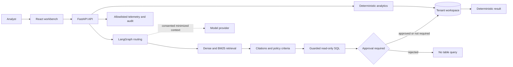

# Conversational BI with Evidence in View

### A review-first AI workbench for asking business questions across tables and policy documents

[](https://github.com/mehaksharma1996/conversational-multi-agent-bi/actions/workflows/ci.yml)
[](LICENSE)


Upload CSV or Excel data and PDF policies, ask questions in plain language, and inspect the sources,
SQL, result rows, and safeguards behind each answer. The primary product is a React workbench over a
versioned FastAPI API. LangGraph coordinates deterministic analytics, guarded SQL, document
retrieval, conversational memory, and hybrid policy-to-data workflows.

Models interpret language; deterministic code owns access control, query safety, evidence checks,
approval boundaries, and calculations.

<p align="center">
  
</p>

*Authentic capture from the automated browser journey. The journey uses a deterministic scripted
provider, so it demonstrates the product workflow and guardrails, not live-model accuracy.*

## A business question, traced end to end

Imagine an operations manager asking: **How many transactions meet the fulfillment escalation
rule?** The uploaded policy says that a fulfillment time of 10 days or more requires escalation.
The workbench:

1. retrieves the relevant PDF passage and produces a source-linked policy answer;
2. extracts the attributable predicate `fulfillment_days >= 10`;
3. drafts SQL, then checks its statement type, schema, functions, limits, and policy coverage;
4. optionally pauses before execution so a person can approve, reject, or edit the query;
5. revalidates any edit, runs against a read-only table copy, and calculates the result from rows;
6. returns **13 matching transactions** in the committed 2,400-row synthetic dataset.

The sequence matters: policy evidence is retrieved before criteria are extracted, and validated SQL
is approved before it can execute. A rejected or policy-inconsistent query does not run. The
[eight-minute walkthrough](docs/operations/demo-walkthrough.md) reproduces the full scenario.

## What makes the system useful

- **Bounded agent orchestration.** LangGraph routes table, document, memory, hybrid, and unsupported
  questions. Schema-constrained model outputs receive at most one repair; invalid paths fail safely.
- **Guarded SQL execution.** A model may draft one read-only `SELECT` or CTE, but parser checks,
  table/column/function allowlists, SQLite's authorizer, a read-only connection, a 500-row cap, and a
  five-second deadline decide what runs.
- **Grounded document retrieval.** Dense search and BM25 are fused behind a relevance gate, with an
  optional local reranker. Citation numbers and quoted substrings are checked against retrieved text.
- **Policy-to-SQL verification.** Source-attributed predicates are compared structurally with the
  generated query; missing, conflicting, or unjustified business conditions cause refusal or a
  document-only fallback.
- **Human approval at the execution boundary.** Hybrid SQL can pause at a server-owned checkpoint.
  Edited SQL passes the complete safety and policy validation path again.
- **Deterministic decision support.** Profiles, trends, anomaly candidates, classifier metrics,
  report generation, identity/tenant controls, audit records, and evaluation gates do not depend on
  a model agreeing with a prompt.

This is not an autonomous agent consensus system. It is a bounded workflow that keeps model
proposals inspectable and places guarantees in code.

## Architecture at a glance



The [system overview](docs/architecture/system-overview.md) shows the exact route lifecycle, storage
paths, trust boundaries, and local container topology.

## Evidence and engineering depth

- **85 deterministic evaluation cases** cover routing, SQL, retrieval, hybrid policy checks,
  injection handling, tenant isolation, privacy, recovery, and the read-only MCP surface using
  scripted providers through the real guards.
- **20 Chromium journeys** exercise the React client and real API, including upload, schema review,
  PDF citations, approval and safe editing, restart recovery, export, and phone-width layout.
- **Container CI** builds and scans digest-pinned non-root images, starts the Compose topology, checks
  hardening and recovery, and runs browser journeys. pgvector, OpenAPI compatibility, dependencies,
  licenses, and secrets have separate checks.
- **Authentication and durability** are covered by deterministic tests for JWT/OIDC flows, PKCE,
  sessions, CSRF/Origin checks, capabilities, tenant isolation, migrations, backup/restore, and
  single-process workspace recovery.
- **Live-model evidence is deliberately narrow:** one preserved Gemini hybrid run made four
  successful model calls, extracted `fulfillment_days >= 10`, passed the structural policy check,
  and returned 13. It is one controlled result, not a success rate.

See [release readiness](docs/operations/release-readiness.md) for evidence classes and caveats, and
the [portfolio walkthrough](docs/portfolio-walkthrough.md) for the deterministic/model boundary.

## Run it locally

The shortest path is local-only Compose; it needs no model key and sends no content to a hosted
provider:

```powershell
$env:LOCAL_ONLY_MODE = "true"
docker compose up -d --build --wait
# open http://127.0.0.1:8080
```

Choose **Load demo data and policy**, confirm the proposed schema, and run the deterministic
analysis. Stop while retaining data with `docker compose down`. See
[local container operations](docs/operations/local-containers.md) for backup, restore, upgrades, and
the intentional `docker compose down -v` reset.

For local development, create a Python 3.12-3.14 virtual environment, install
`requirements.lock`, run `python -m uvicorn apps.api.main:app --port 8000`, then use `npm ci` and
`npm run dev` from `apps/web/`. The sample files and ground truth are versioned in
[`sample_data/`](sample_data/README.md). A hosted provider is contacted only when configured,
local-only mode is disabled, and the disclosure is accepted.

## Boundaries, stated plainly

- This is a **local, single-node workbench**, not a public deployment. The bundled stack is
  loopback-only; live identity-provider integration, TLS, anti-abuse controls, hosted storage, and
  per-user cost controls have not been validated.
- Safe SQL is not necessarily correct SQL. The UI exposes the query, rows, citations, and limits so
  a person can review the evidence before acting.
- Prompt injection is mitigated by untrusted-context labelling and deterministic output checks, not
  eliminated. A valid citation proves a mapping to retrieved text, not that the source is true.
- SQLite/Chroma recovery is designed for one API process, not horizontal scale. The vector index is
  unencrypted under a documented waiver, and pending approvals fail safely after restart.
- Anomaly and classifier outputs are review candidates; they do not prove fraud, misconduct,
  causality, or eligibility. Calibrated multi-run live-model evaluation remains open.

## Explore the engineering

[Architecture and trust boundaries](docs/architecture/system-overview.md) ·
[Policy-to-SQL verifier](docs/architecture/policy-sql-predicate-verification.md) ·
[Evaluation methodology](docs/governance/evaluation.md) ·
[Threat model](docs/security/threat-model.md) ·
[ADR index](docs/adr/README.md) ·
[Read-only MCP server](docs/operations/mcp-server.md)

Licensed under the [MIT License](LICENSE).
