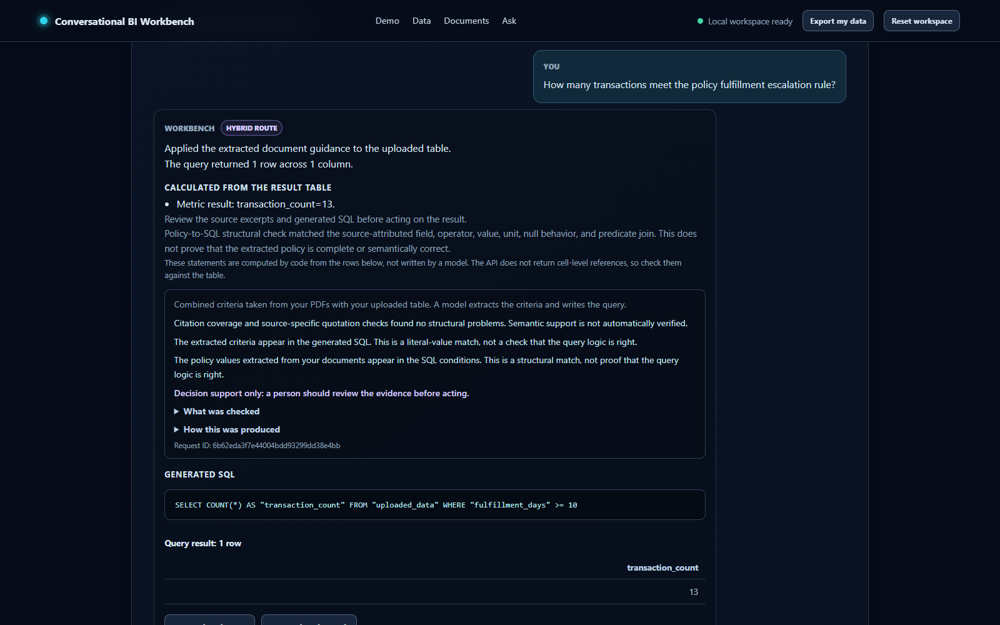

# Conversational BI with Evidence in View

### A review-first AI workbench for asking business questions across tables and policy documents

[](https://github.com/mehaksharma1996/conversational-multi-agent-bi/actions/workflows/ci.yml)
[](LICENSE)


Upload CSV or Excel data and PDF policies, ask questions in plain language, and inspect the sources,
SQL, result rows, and safeguards behind each answer. The primary product is a React workbench over a
versioned FastAPI API. LangGraph coordinates deterministic analytics, guarded SQL, document
retrieval, conversational memory, and hybrid policy-to-data workflows.

Models interpret language; deterministic code owns access control, query safety, evidence checks,
approval boundaries, and calculations.

<p align="center">
  
</p>

*Authentic capture from the automated browser journey. The journey uses a deterministic scripted
provider, so it demonstrates the product workflow and guardrails, not live-model accuracy.*

[View the complete six-screenshot portfolio sequence.](docs/portfolio-screenshots.md)

## Start here

| To... | Read |
| --- | --- |
| Understand what it does | [A business question, traced end to end](#a-business-question-traced-end-to-end) · [Portfolio walkthrough](docs/portfolio-walkthrough.md) |
| Run it locally | [Run it locally](#run-it-locally) · [Local container operations](docs/operations/local-containers.md) |
| Reproduce the offline investigation demo | [Multi-agent investigations](#multi-agent-investigations) · [Investigation guide](docs/investigation.md) |
| Explore architecture and decisions | [System overview](docs/architecture/system-overview.md) · [ADR index](docs/adr/README.md) |
| Review evaluation and security evidence | [Evaluation methodology](docs/governance/evaluation.md) · [Threat model](docs/security/threat-model.md) · [Release readiness](docs/operations/release-readiness.md) |
| Check limitations | [Boundaries, stated plainly](#boundaries-stated-plainly) · [What is not production-ready](docs/investigation.md#what-is-not-production-ready) |

## A business question, traced end to end

Imagine an operations manager asking: **How many transactions meet the fulfillment escalation
rule?** The uploaded policy says that a fulfillment time of 10 days or more requires escalation.
The workbench:

1. retrieves the relevant PDF passage and produces a source-linked policy answer;
2. extracts the attributable predicate `fulfillment_days >= 10`;
3. drafts SQL, then checks its statement type, schema, functions, limits, and policy coverage;
4. optionally pauses before execution so a person can approve, reject, or edit the query;
5. revalidates any edit, runs against a read-only table copy, and calculates the result from rows;
6. returns **13 matching transactions** in the committed 2,400-row synthetic dataset.

The sequence matters: policy evidence is retrieved before criteria are extracted, and validated SQL
is approved before it can execute. A rejected or policy-inconsistent query does not run. The
[eight-minute walkthrough](docs/operations/demo-walkthrough.md) reproduces the full scenario.

## How to inspect an answer

Answers take different routes, so check only the evidence that applies to the answer shown:

1. **Sources (document and hybrid).** Open each cited excerpt and page. A verified citation points
   at retrieved text; it does not prove the source is correct.
2. **Criteria (hybrid).** Compare each extracted condition, such as `fulfillment_days >= 10`, with
   the policy wording; *What was checked* reports how many were compared with the SQL.
3. **SQL (table and hybrid).** Read the query. Safety checks confirm it is read-only and within
   allowed tables, columns, and limits, not that it answers the right question.
4. **Approval (when required).** Review the query before it runs; an edited query repeats the safety
   and policy checks and may fall back to a document-only answer.
5. **Rows and calculations.** Check the returned rows and the deterministically calculated result
   rather than relying on the model's explanation alone.

Scripted runs demonstrate these checks, not live-model accuracy; the
[demo walkthrough](docs/operations/demo-walkthrough.md) steps through each one.

## What makes the system useful

- **Bounded agent orchestration.** LangGraph routes table, document, memory, hybrid, and unsupported
  questions. Schema-constrained model outputs receive at most one repair; invalid paths fail safely.
- **Guarded SQL execution.** A model may draft one read-only `SELECT` or CTE, but parser checks,
  table/column/function allowlists, SQLite's authorizer, a read-only connection, a 500-row cap, and a
  five-second deadline decide what runs.
- **Grounded document retrieval.** Dense search and BM25 are fused behind a relevance gate, with an
  optional local reranker. Citation numbers and quoted substrings are checked against retrieved text.
- **Policy-to-SQL verification.** Source-attributed predicates are compared structurally with the
  generated query; missing, conflicting, or unjustified business conditions cause refusal or a
  document-only fallback.
- **Human approval at the execution boundary.** Hybrid SQL can pause at a server-owned checkpoint.
  Edited SQL passes the complete safety and policy validation path again.
- **Deterministic decision support.** Profiles, trends, anomaly candidates, classifier metrics,
  report generation, identity/tenant controls, audit records, and evaluation gates do not depend on
  a model agreeing with a prompt.

This is not an autonomous agent consensus system. It is a bounded workflow that keeps model
proposals inspectable and places guarantees in code.

## Architecture at a glance


The React client talks to a versioned FastAPI service. Identity, tenant scope, and consent are enforced
before any question reaches the LangGraph orchestrator, which routes it to the guarded SQL path, the
document RAG path, or both for hybrid questions. The model provider only proposes routes, answers,
criteria, and SQL; code validates and executes, and the result summary is computed without the model.
Observability is allowlisted and the audit log is hash-chained. The API, orchestration, and
workspace stores run in one local process; hosted model providers are used only after consent.

The distinctive path is hybrid policy-to-SQL: policy text is retrieved and cited first, criteria are
extracted and checked against the excerpts, and the drafted SQL must pass the safety check and a
structural policy check (plus optional human approval, after which both checks repeat) before it runs
read-only.


The [system overview](docs/architecture/system-overview.md) has the full route lifecycle, storage
paths, trust boundaries, and local container topology. The diagrams were generated with Archify; their specifications, with
per-node source-line citations, are under [`.archify/`](.archify/).

## Multi-agent investigations

Some questions need more than one query, such as "Why did customer churn increase last quarter?" An
investigation has models propose hypotheses and SQL, a person approve the plan and each batch of SQL,
and deterministic code run the work and decide the verdicts. Each hypothesis test's counts must match a
computation compiled from the approved specification, so a read-only statement that invents or
relabels numbers leaves that test `untestable`. That check shows agreement with the authorized source
table. It does not show that the source data is accurate.

**The workflow has run with scripted models only.** Routing is off by default, and no real provider is
admitted, so a real-model run fails closed with `metering_unbounded`. The results below are scripted
evidence, not real-model performance.

Reproduce the churn investigation with no API key, Docker, network, or spend:

```powershell
python -m tests.e2e.investigation_demo
```

It runs through the production API with scripted model outputs, approves over HTTP, shows a forged
count being rejected, and compares the result with a committed expected file. The
[investigation guide](docs/investigation.md) explains the architecture, the expected output, the
[evaluation evidence](docs/investigation.md#evaluation-what-the-numbers-mean), and
[what is not production-ready](docs/investigation.md#what-is-not-production-ready).

## Evidence and engineering depth

- **85 deterministic evaluation cases** ([scripted](evals/v1/baseline.json); regenerate with
  `python -m scripts.run_evaluations`) cover routing, SQL, retrieval, hybrid policy checks, injection
  handling, tenant isolation, privacy, recovery, and the read-only MCP surface using scripted
  providers through the real guards.
- **43 investigation trajectory cases** ([scripted](evals/investigation/v1/trajectory-baseline.json);
  regenerate with `python -m tests.e2e.investigation_trajectory_runner`) run the real investigation
  graph. A pass means the application still handles those scripted outputs as recorded. It is not an
  accuracy rate.
- **37 Chromium journeys** ([scripted provider](apps/web/e2e/real/); list them with
  `E2E_REAL_STACK=scripted npx playwright test --list`) exercise the React client and real API,
  including upload, schema review, PDF citations, approval and safe editing, investigations, restart
  recovery, export, and phone-width layout.
- **Container CI** builds and scans digest-pinned non-root images, starts the Compose topology, checks
  hardening and recovery, and runs browser journeys. pgvector, OpenAPI compatibility, dependencies,
  licenses, and secrets have separate checks.
- **Authentication and durability** are covered by deterministic tests for JWT/OIDC flows, PKCE,
  sessions, CSRF/Origin checks, capabilities, tenant isolation, migrations, backup/restore, and
  single-process workspace recovery.
- **Live-model evidence is deliberately narrow:** one preserved Gemini hybrid run
  ([measured](docs/operations/release-readiness.md)) made four successful model calls, extracted
  `fulfillment_days >= 10`, passed the structural policy check, and returned 13. It is one controlled
  result on the hybrid question path, not a success rate, and not an investigation.

See [release readiness](docs/operations/release-readiness.md) for evidence classes and caveats, and
the [portfolio walkthrough](docs/portfolio-walkthrough.md) for the deterministic/model boundary.

## Run it locally

The shortest path is local-only Compose; it needs no model key and sends no content to a hosted
provider:

```powershell
$env:LOCAL_ONLY_MODE = "true"
docker compose up -d --build --wait
# open http://127.0.0.1:8080
```

Choose **Load demo data and policy**, confirm the proposed schema, and run the deterministic
analysis. Stop while retaining data with `docker compose down`. See
[local container operations](docs/operations/local-containers.md) for backup, restore, upgrades, and
the intentional `docker compose down -v` reset.

For local development, create a Python 3.12-3.14 virtual environment, install
`requirements.lock` (Streamlit, the developer-only compatibility UI, has its own environment:
[docs/operations/streamlit-developer-environment.md](docs/operations/streamlit-developer-environment.md)), run
`python -m uvicorn --factory apps.api.runtime:create_runtime_app --port 8000`, then use `npm ci` and
`npm run dev` from `apps/web/`. The sample files and ground truth are versioned in
[`sample_data/`](sample_data/README.md). A hosted provider is contacted only when configured,
local-only mode is disabled, and the disclosure is accepted.

## Boundaries, stated plainly

- This is a **local, single-node workbench**, not a public deployment. The bundled stack is
  loopback-only; live identity-provider integration, TLS, anti-abuse controls, hosted storage, and
  per-user cost controls have not been validated.
- Safe SQL is not necessarily correct SQL. The UI exposes the query, rows, citations, and limits so
  a person can review the evidence before acting.
- Prompt injection is mitigated by untrusted-context labelling and deterministic output checks, not
  eliminated. A valid citation proves a mapping to retrieved text, not that the source is true.
- SQLite/Chroma recovery is designed for one API process, not horizontal scale. The vector index is
  unencrypted under a documented waiver, and pending approvals fail safely after restart.
- Anomaly and classifier outputs are review candidates; they do not prove fraud, misconduct,
  causality, or eligibility. Calibrated multi-run live-model evaluation remains open.

## Explore the engineering

[Multi-agent investigations](docs/investigation.md) ·
[Architecture and trust boundaries](docs/architecture/system-overview.md) ·
[Policy-to-SQL verifier](docs/architecture/policy-sql-predicate-verification.md) ·
[Evaluation methodology](docs/governance/evaluation.md) ·
[Threat model](docs/security/threat-model.md) ·
[ADR index](docs/adr/README.md) ·
[Read-only MCP server](docs/operations/mcp-server.md)

Licensed under the [MIT License](LICENSE).
