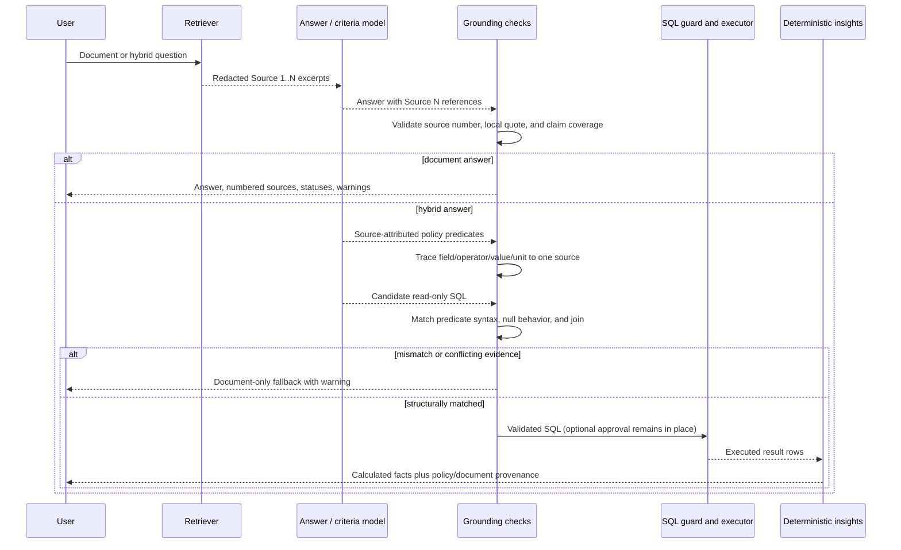

# Evidence grounding and policy-to-SQL verification

## Scope

Document and hybrid answers use deterministic evidence checks around model output. These checks
reduce citation and policy-translation errors; they do not eliminate hallucinations or prove that a
paraphrased claim is semantically entailed by a passage.

## Evidence flow

## Citation identifiers and provenance

`Source N` is a stable ordinal only within one answer. It is assigned from the final ordered,
deduplicated retrieval result. The corresponding API source entry starts with the same label and
includes the original filename, page span, chunk index, relevance score when available, and a
redacted excerpt. Persistent document metadata remains tenant-scoped in the document store; clients
cannot select another tenant or source identifier.

Quote validation is source-specific. A quote attributed to Source 1 must appear in the redacted
Source 1 text supplied to the model; finding it only in Source 2 is a mismatch. Validation and API
excerpts use the same redaction function, and warnings expose counts rather than sensitive text.

Likely factual sentences are checked for a local valid reference. This is a conservative structural
heuristic. `NOT_EVALUATED` remains present because a syntactically valid citation does not establish
semantic entailment, completeness, or truth.

## Evidence statuses

| Status | Meaning |
|---|---|
| `VERIFIED_REFERENCE` | At least one reference points to a retrieved source. |
| `INVALID_REFERENCE` | A cited `Source N` was not retrieved for this answer. |
| `QUOTE_MISMATCH` | A quotation was not found in the locally cited redacted source. |
| `MISSING_EVIDENCE` | No valid source reference was present. |
| `UNVERIFIED_CLAIM` | A likely factual statement lacked a local valid reference. |
| `CONFLICTING_EVIDENCE` | Structured policy predicates conflict and were not executed. |
| `NOT_EVALUATED` | Semantic support was not established by deterministic checks. |

Multiple statuses may apply. Existing `grounding_status` remains for backward compatibility and is
`checked_no_issues`, `uncited`, or `warnings` according to the structural results.

## Hybrid policy predicates

When possible, hybrid criteria include source-attributed predicates with a table field, operator,
value, unit, source number, and null behavior, plus an `all`/`any` join. Unallowlisted table fields,
invalid source numbers, untraceable values or operators, and oversized payloads are dropped before
they reach the SQL prompt.

After the ordinary read-only SQL guard succeeds, the policy verifier checks that each predicate has
the same field, exclusive or inclusive operator, literal value, unit representation, null behavior,
and join in SQL. It performs no implicit percentage conversion. A mismatch or contradiction falls
back to the grounded document answer before approval or execution. Corrected or approval-edited SQL
passes through the same checks again.

Legacy flat criteria remain supported, but receive `not_evaluated`; their literal-overlap provenance
is not presented as semantic verification. A `structurally_verified` result proves only the bounded
syntax correspondence above. It does not prove that extraction captured every policy rule, resolve
policy ambiguity, or establish that the query answers the user's full intent.

## Security and failure boundaries

- Retrieved text remains untrusted data and cannot change SQL or tool permissions.
- Existing SQL allowlists, read-only execution, timeout, result cap, and optional approval remain
  authoritative.
- Missing retrieval evidence refuses before generation.
- Citation validation adds no model call or retry.
- Policy verification is local and bounded to at most 20 extracted predicates.
- Invalid or conflicting structured policy evidence cannot authorize SQL execution.
- Diagnostics and telemetry contain counts and enum statuses, not questions, SQL, rows, excerpts,
  quotes, prompts, or secrets.

## Evaluation boundary

The offline suite deterministically covers invalid source numbers, wrong-source and altered quotes,
partial citation coverage, empty retrieval, prompt injection, policy operator mismatch, conflicting
evidence, approval resume, provider failures, SQL safety, and tenant isolation. Retail integration
also exercises the committed CSV and PDF through retrieval, predicate extraction, guarded SQL, and
deterministic insights.

Real-model wording quality, semantic entailment, real embedding recall, and human interpretation
still require bounded live-model evaluation and review. They are not claimed by these gates.
