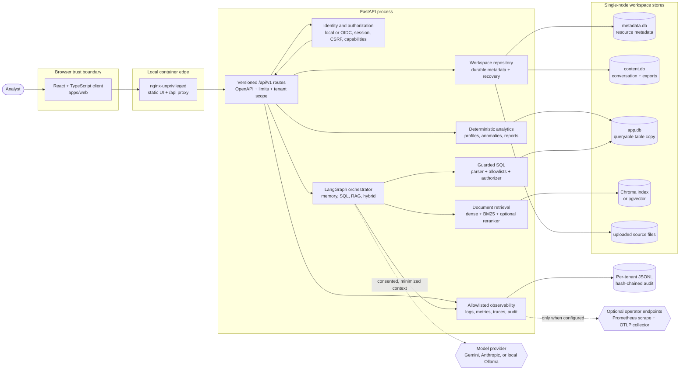
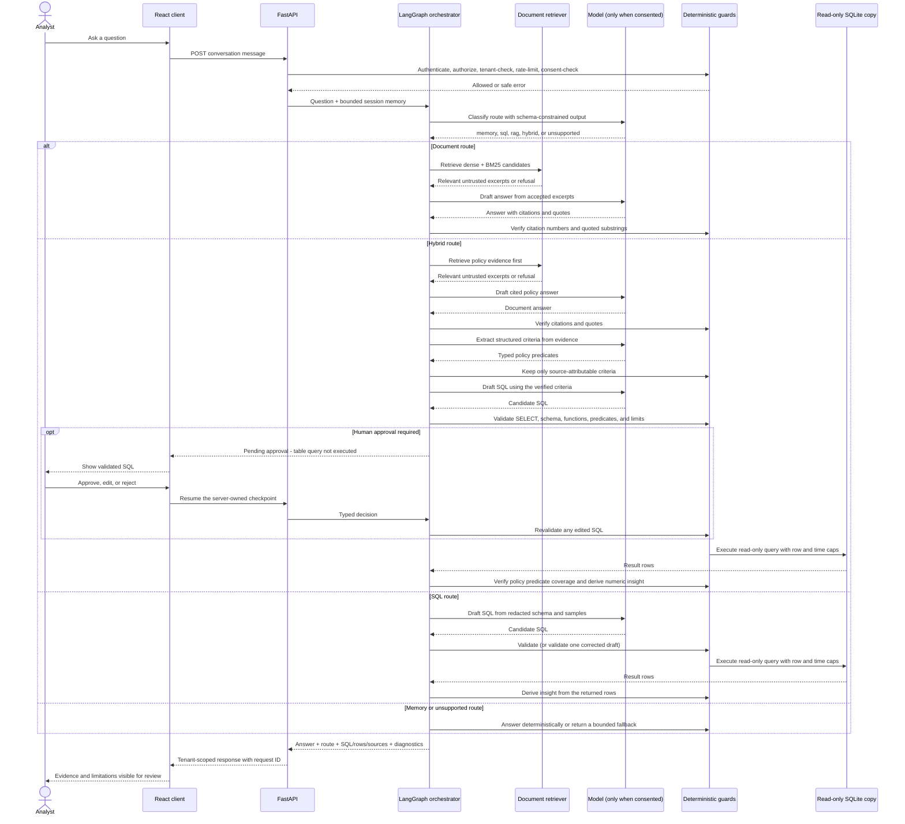
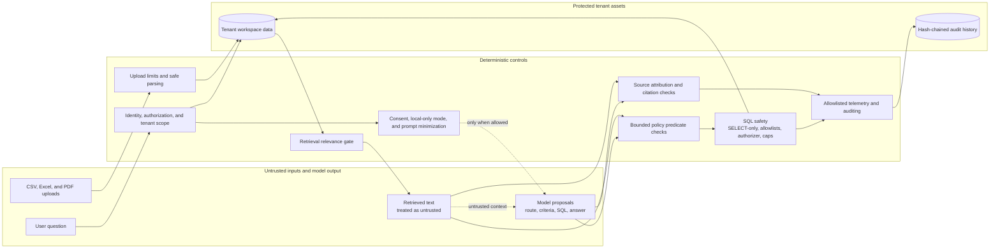

# System overview: architecture, query lifecycle, and trust boundaries

Current-state diagrams for the primary React/FastAPI product, reconciled with `origin/main` at
`8d0360ad` on 2026-10-13. Mermaid renders on GitHub. The diagrams describe implemented code; future
or deployment-specific work appears only in [Current versus target](#current-versus-target).

The older `conversational-bi-architecture.png` predates the React/FastAPI split and is retained only
as a historical artifact.

## A. Current system architecture

The default Compose topology runs one API process and publishes only nginx on
`127.0.0.1:8080`. Images are digest-pinned, non-root, scanned in CI, and carry no secrets. The API
and `/metrics` are not exposed by the bundled nginx proxy. See
[local containers](../operations/local-containers.md).

## B. Actual query lifecycle

The order matters on the hybrid route: document retrieval and the cited document answer happen
before evidence-attributed criteria are extracted and used to draft SQL.

A rejected approval stops without querying the table. An edited query passes the complete validation
and policy-predicate checks again. Query results are summarized by deterministic code and are not sent
back to the model. The implementation and state transitions are detailed in
[LangGraph SQL approval](langgraph-sql-approval.md).

## C. Grounding and trust boundaries

Provider and OIDC credentials remain server-side. They must not be recorded in logs, metrics,
traces, or audit events, and they must never be exposed to the browser.

The model does not receive authority because it cannot bypass identity, consent, retrieval admission,
SQL validation, tenant scoping, or execution limits. Grounding is still bounded: valid citations show
that an answer maps to retrieved text, not that the source is correct. See the
[threat model](../security/threat-model.md), [data classification](../governance/data-classification.md),
and [policy-to-SQL verifier](policy-sql-predicate-verification.md).

## Current versus target

| Area | Implemented and tested now | Remaining deployment or research boundary |
|---|---|---|
| Identity | OIDC Bearer validation, authorization-code + PKCE browser login, HttpOnly sessions, CSRF/Origin checks, roles/capabilities, and auth audit events | Validate against a live IdP and define TLS, account, abuse, and public-hosting operations before lifting loopback-only exposure |
| Persistence | Versioned SQLite metadata and per-workspace content/index stores recover on one API process; backup/restore, deletion, migrations, and corruption paths are tested | Multi-process coordination and horizontal scale are not implemented; in-flight jobs do not recover and pending approvals are rejected on restart |
| Vector storage | Local Chroma (unencrypted under ADR 0021) or tested pgvector adapter | Select and validate encryption/managed storage for any hosted deployment |
| Retrieval | Dense + BM25 fusion, relevance refusal, metadata filters, and an opt-in pinned local cross-encoder reranker | Query rewriting and quality measurement with a selected real reranker/model |
| Observability | Allowlists, structured logs, opt-in Prometheus metrics, W3C request/job trace correlation, opt-in OTLP export, hash-chained audit | No bundled collector, scraper, dashboard, alert delivery, or end-to-end monitoring profile |
| Evaluation | 85 deterministic offline cases, 20 scripted-provider browser journeys, and one preserved successful live Gemini hybrid run | Calibrated multi-run live-model and real-embedding/reranker quality evaluation |
| Containers | Hardened images and Compose are built, scanned, smoke-tested, and browser-tested in Linux CI | No public deployment; Docker Desktop hosts and live-OIDC Compose integration are not CI claims |
