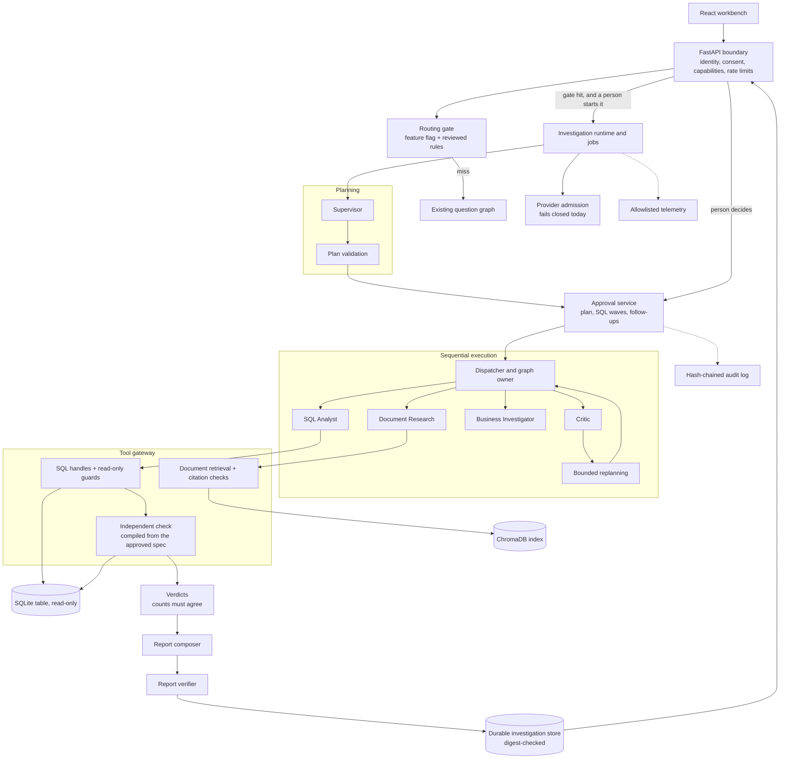

# Multi-agent investigations: how they work and how to reproduce them

**Status.** The workflow is implemented and tested on scripted models only. Investigation routing is
off by default, and no real model provider is admitted. A real-model run fails closed with
`metering_unbounded`.

[Run the demo](#reproduce-it-offline) · [Architecture](#architecture) ·
[Evaluation](#evaluation-what-the-numbers-mean) · [What is not production-ready](#what-is-not-production-ready)

## The problem

A question like "Why did customer churn increase last quarter?" cannot be answered by one SQL query.
It needs several hypotheses, each tested against a table and read against company documents. A
language model can propose that work, but it can also write wrong SQL, invent numbers, or be misled by
a document. An analyst needs to control what runs, and needs to be able to trust the numbers in the
result.

An investigation lets models propose plans and SQL. A person approves them, and deterministic code
runs the work and decides what the evidence shows.

**Intended users:** analysts and operations leads who review evidence before acting on it, and
engineers evaluating how to put guardrails around a multi-step agent. This is a local portfolio
project. It has no production deployment and no real users.

## What works today

- A deterministic router recommends an investigation for an eligible question. Nothing starts until a
  person asks for it.
- A planner proposes hypotheses and typed tests, and code validates the plan before anyone sees it.
- A person approves the plan, then each batch of SQL statements, and can reject or edit a statement.
- SQL and document specialists run approved tasks one at a time through a single gateway.
- Each hypothesis test's counts are compared with a computation compiled from the approved
  specification.
- A Critic checks claims against the evidence and can request up to two rounds of follow-up tests,
  only if the approver delegated them.
- A verifier checks the report, and the React workbench shows it with its evidence and exports.

## Models and code

| Models propose (untrusted) | Code decides |
|---|---|
| The plan: hypotheses and typed tests | Whether the plan is valid, and its digest |
| SQL text for each task | Read-only safety, table and column allowlists, row and time limits |
| A document answer with citations | Whether each citation matches a retrieved passage |
| A findings draft | Every number and citation in it is recomputed |
| Stratification gaps for the Critic | Whether a gap is real, and whether a follow-up is allowed |
| The order and choice of report claims | All report wording, from reviewed templates, and every number |
| Nothing | Routing, approvals, verdicts, budgets, consent, and tenant scope |

The rule behind this table: **verdicts come only from counts that agree with the independent check,
and never from a model's prose, the plan, or a document.**

## How a run moves

**1. Routing and the feature flag.** `INVESTIGATION_ROUTING_ENABLED` is read from the server's
environment and defaults to off. A request, document, or model cannot turn it on. With it on, finite
reviewed rules match the current question against an authorized table. A hit returns a message that an
investigation is recommended and that nothing has started. A miss stays on the existing
SQL/document/hybrid question graph.

**2. Planning.** The Supervisor makes one planning call, and at most one repair call, seeing only the
question, schema names, and document titles. Validation requires real schema fields, known roles, and
a minimum denominator. Two invalid candidates end in `plan_invalid`.

**3. Plan approval.** A person sees the plan, the cost estimate, and what is missing. Approval binds
the exact plan digest and authority epoch, so a changed plan is refused with `plan_digest_mismatch`.
The approver also chooses how many follow-up rounds to delegate, from zero (the default) to two. An
approval expires after 24 hours, or when the workspace expires if that is sooner.

**4. Specialists and SQL-wave approval.** The dispatcher runs one task at a time. Document research
retrieves passages and checks citations. The SQL Analyst gets its statement validated and parked. When
nothing else can proceed, every parked statement becomes one wave, and the run pauses. A person
approves, edits, or rejects each statement. An edit goes through full validation again, and a rejected
statement never runs. Handles are single-use and expire after ten minutes.

**5. Independent verification of hypothesis tests.** Read-only SQL can still lie. It can return made-up
counts, or real counts from another population under the approved label. So after an approved
statement runs, the gateway runs a second statement in the same operation. It is compiled only from the
approved test specification and trusted table metadata, holds no model text, and binds every value as
a parameter. The test's counts must match it exactly (a sum within a relative tolerance of 1e-9).
Otherwise the test is `untestable` with a fixed reason, and its rows are withheld from the report.

This is a narrow exception to the rule that a person approves every statement: nothing in the compiled
statement comes from a model, and its inputs are already bound by the approved plan digest. See
[ADR 0024 Amendment 13](adr/0024-multi-agent-investigation.md#amendment-13-independent-verification-of-hypothesis-tests-214-2026-11-04).
Each check also spends one of the run's 15 SQL executions.

**It is not proof that the data is right.** A pass means agreement with the authorized source table
under the approved definitions. A wrong source table, a misguided metric that a person approved, or a
column whose name misdescribes it all pass. Rows from untyped analysis tasks have no specification to
check, so they are labelled unconfirmed and decide nothing.

**6. Verdicts.** Code computes each verdict from confirmed counts:

| Verdict | Meaning |
|---|---|
| `supported_association` | Every test's effect in the claimed direction reaches the approved minimum |
| `refuted` | Every test is usable, and the effect is zero or in the opposite direction |
| `untestable` | The evidence cannot decide, and a fixed reason says why |

A hypothesis can only claim an association. A `causation` claim is rejected.

**7. Critic and bounded replanning.** The Critic recomputes findings from verified evidence, such as a
document that contradicts the data, a numeric mismatch, or causal overreach. The Critic model can only
propose stratification gaps. It sees no rows, numbers, or document text, and it cannot withdraw a
finding or change a verdict. A confirmed gap becomes a follow-up task only if the approver delegated a
round and approved that exact task set. There are at most two follow-up rounds, and follow-up SQL goes
through wave approval as well.

**8. Evidence-backed report.** Facts are computed with exact arithmetic from confirmed counts, and every
fact and verdict cites evidence from this run. A narrative model may only choose and order typed claims.
It writes no sentences. If the narrative fails verification, the reviewed deterministic report is used
instead, and if that also fails, no report is returned. Each report states what "verified" covers.
Reports are stored with a digest, and a stored report is shown only if the digest still matches.

## Security, consent, tenant isolation, and budgets

- **Tenant isolation.** Every route resolves records through the verified tenant, and a foreign ID gets
  the same 404 as an unknown one.
- **Consent.** Consent is re-read before each tool runs. If it is withdrawn, approvals are refused and
  nothing more is sent. Reads and cancel stay available.
- **Capabilities.** Each route checks one, and SQL text is withheld from a viewer.
- **Rate limits.** Creates and decisions are limited per tenant, with a bounded 429. Cancel is never
  limited, so a stop cannot be refused.
- **Budgets.** Each stage has a fail-closed ledger that reserves the worst case before work starts:

| Limit | Planning | Execution |
|---|---|---|
| Model calls | 2 | 30 |
| Input / output tokens | 12,000 / 4,000 | 150,000 / 25,000 |
| SQL executions | 0 | 15 |
| Retrievals | 0 | 8 |
| Task attempts | 0 | 12 |
| Replan / Critic rounds | 0 / 0 | 2 / 2 |
| Wall clock | 30 s | 240 s |

Limits come from [`packages/investigation/budget.py`](../packages/investigation/budget.py). The
red-team cases, the residual risks, and the two open review findings are in the
[threat model, section 8](security/threat-model.md#8-multi-agent-investigations).

## Architecture

This diagram shows code on `main`. It all runs in one local API process, and nothing here is a
separately deployed service. Specialists can reach data and models only through the tool gateway.



| Node | Component | Source |
|---|---|---|
| `client` | React workbench | [`apps/web/`](../apps/web/) |
| `api` | Investigation routes and hardening | [`apps/api/investigation_routes.py`](../apps/api/investigation_routes.py) |
| `gate` | Deterministic routing gate | [`src/orchestration/investigation_routing.py`](../src/orchestration/investigation_routing.py) |
| `questions` | Existing question graph | [`src/orchestration/langgraph_orchestrator.py`](../src/orchestration/langgraph_orchestrator.py) |
| `runtime` | Investigation runtime and jobs | [`apps/api/investigations.py`](../apps/api/investigations.py) |
| `admission` | Provider admission | [`apps/api/investigation_providers.py`](../apps/api/investigation_providers.py) |
| `supervisor` | Supervisor | [`src/investigation/supervisor.py`](../src/investigation/supervisor.py) |
| `validation` | Plan validation | [`packages/investigation/validation.py`](../packages/investigation/validation.py) |
| `approvals` | Approval service | [`src/orchestration/investigation_approval.py`](../src/orchestration/investigation_approval.py) |
| `dispatcher` | Execution owner and dispatch | [`src/orchestration/investigation_execution.py`](../src/orchestration/investigation_execution.py) |
| `analyst` | SQL Analyst | [`src/investigation/sql_analyst.py`](../src/investigation/sql_analyst.py) |
| `researcher` | Document Research | [`src/investigation/document_researcher.py`](../src/investigation/document_researcher.py) |
| `investigator` | Business Investigator | [`src/investigation/business_investigator.py`](../src/investigation/business_investigator.py) |
| `critic` | Critic | [`src/investigation/critic.py`](../src/investigation/critic.py) |
| `replanning` | Follow-up planning | [`packages/investigation/replanning.py`](../packages/investigation/replanning.py) |
| `sql_gateway` | SQL gateway | [`src/orchestration/tool_gateway.py`](../src/orchestration/tool_gateway.py) |
| `doc_gateway` | Document gateway | [`src/orchestration/document_research.py`](../src/orchestration/document_research.py) |
| `check` | Independent check | [`src/orchestration/independent_check.py`](../src/orchestration/independent_check.py) |
| `table` | Read-only table execution | [`src/storage/sqlite_store.py`](../src/storage/sqlite_store.py) |
| `vectors` | Local vector index | [`src/documents/`](../src/documents/) |
| `verdicts` | Verdict rules | [`packages/investigation/verdicts.py`](../packages/investigation/verdicts.py) |
| `composer` | Report composer | [`packages/investigation/report_composer.py`](../packages/investigation/report_composer.py) |
| `verifier` | Report verifier | [`packages/investigation/report_verifier.py`](../packages/investigation/report_verifier.py) |
| `store` | Durable records and content | [`apps/api/investigation_store.py`](../apps/api/investigation_store.py) |
| `telemetry` | Investigation telemetry | [`src/orchestration/investigation_telemetry.py`](../src/orchestration/investigation_telemetry.py) |
| `audit` | Audit sinks | [`packages/governance/audit.py`](../packages/governance/audit.py) |

Decisions are in [ADR 0024](adr/0024-multi-agent-investigation.md). Mechanics, including every refusal
code, are in the [investigation workflow reference](architecture/investigation-workflow.md).
`tests/test_investigation_demo.py` fails if a node here has no row, or a row has no module.

## Reproduce it offline

This needs Python 3.12 to 3.14 and the locked dependencies. It needs no API key, no Docker, and no
network, and it spends nothing. It takes about a minute.

```powershell
python -m venv .venv
.venv\Scripts\Activate.ps1
python -m pip install -r requirements.lock
python -m tests.e2e.investigation_demo
```

The command exits 1 if the result differs from
[`evals/investigation/v1/demo-expected.json`](../evals/investigation/v1/demo-expected.json), naming each
difference. The full result is written to `evals/results/investigation-demo.json`, and it holds every
fact, finding, and evidence reference. Evidence references are shown as `kind:task` because IDs are
random per run. `tests/test_investigation_demo.py` runs the same comparison and checks that the output
below matches it, so neither can drift silently.

**Scripted:** the planner, the SQL text, the document answers, the findings draft, the Critic's review,
the narrative, the embedder, and the person approving (this script, calling the same HTTP routes the
browser calls). The scripted narrative is empty, so the verifier rejects it and the deterministic
report is what you see.

**Real:** the FastAPI routes, routing gate, plan validation, approval service, gateways, read-only SQL
guards, SQLite execution, independent check, verdicts, Critic checks, report verifier, ChromaDB, and
durable storage. The demo reuses the [adapters the browser journeys mount](../tests/e2e/investigation_app.py)
and adds no second pipeline.

Expected output:

<!-- demo-output:start -->
```text
SCRIPTED DEMONSTRATION: no real model was contacted.
Question: Why did customer churn increase last quarter?

Routing gate
  Feature flag on, table ready: eligible (metric_change_causal)
  Feature flag off (the default): not eligible (feature_disabled)
  No table in the conversation: not eligible (authorized_table_missing)
  A single-fact question: not eligible (intent_not_eligible)

Before approval
  status awaiting_plan_approval; execution providers built 0; evidence HTTP 404
  altered plan digest: HTTP 409 plan_digest_mismatch

Approved run
  status completed; label 'verified, association only'; follow-up rounds delegated 1
  SQL wave 1 approved: trend, h1_rate, h2_rate, h2_resolution, h4_rate
  SQL wave 2 approved: h1_rate_r1s0

Hypothesis verdicts
  h1: supported_association (effect_in_claimed_direction)
    f1 h1_rate: 30/500 = 0.0600 -> 70/500 = 0.1400 (+0.0800)
    f2 h1_rate_r1s0: 30/500 = 0.0600 -> 41063/291200 = 0.1410 (+0.0810), standardized by tenure_months_start
    evidence: derived:h1_rate, derived:h1_rate_r1s0, document:pricing, query:h1_rate, query:h1_rate_r1s0
  h2: supported_association (effect_in_claimed_direction)
    f3 h2_rate: 20/400 = 0.0500 -> 36/400 = 0.0900 (+0.0400)
    f4 h2_resolution: 7722/227 = 34.0176 -> 12675/260 = 48.7500 (+14.7324)
    evidence: derived:h2_rate, derived:h2_resolution, document:support, query:h2_rate, query:h2_resolution
  h3: untestable (required_data_absent)
    evidence: document:playbook
  h4: refuted (no_effect_in_claimed_direction)
    f5 h4_rate: 14/700 = 0.0200 -> 14/700 = 0.0200 (0.0000)
    evidence: derived:h4_rate, document:memo, query:h4_rate

Independent check
  confirmed: h1_rate, h1_rate_r1s0, h2_rate, h2_resolution, h4_rate
  no specification to check: trend
  Form A, literal counts: statement returned 2026-01-01: 1/100; 2026-04-01: 50/100; h4 untestable (independent_check_mismatch); rows in report False
  Form B, relabelled population: statement returned 2026-01-01: 30/500; 2026-04-01: 70/500; h4 untestable (independent_check_mismatch); rows in report False

Critic and bounded replanning
  round 0: replan admitted; document_contradiction, incomplete_coverage, missing_stratification
  round 1: replan none_needed; incomplete_coverage

Human decisions and fail-closed paths
  rejected statement h4_rate: status completed_partial; h4 untestable (test_not_completed)
  rejected plan: status plan_rejected; execution providers built 0; evidence HTTP 404
  production configuration: status failed; metering_unbounded; plan produced False

Offline
  non-loopback network attempts: 0; ordinary model calls: 0
  Verified means agreement with the authorized source table under the approved definitions. It is not proof that the source data is accurate or that the definitions are the right ones.
```
<!-- demo-output:end -->

**How to read it.**

- `h4` is the useful case. The sample draft board memo claims Enterprise churn rose. The data says it
  did not (14/700 in both quarters), so the verdict is `refuted`, and the Critic records the
  contradiction.
- Form A has the model's SQL invent counts, and Form B has it return SMB Basic's real numbers labelled
  as Enterprise. Both statements are read-only and a person approved them. Before Amendment 13 both
  turned this refuted hypothesis into `supported_association`. Now both are `untestable`, and neither
  set of rows appears in the report.
- `trend` is unconfirmed because an untyped analysis has no specification to check. No verdict rests on it.
- The correct churn numbers come from committed synthetic data. The test compares them with the
  [evaluator-only oracle](../evals/investigation/v1/oracle.json), which the demo itself never reads.

### Optional: the browser walkthrough

Playwright runs the same scripted investigation through the React workbench, and this needs no Docker:

```powershell
cd apps/web
npm ci
npm run test:e2e:real -- e2e/real/investigation-report.spec.ts
```

The spec is [`investigation-report.spec.ts`](../apps/web/e2e/real/investigation-report.spec.ts). It is a
local command, and CI does not run this spec. It proves the browser and API wiring, and nothing about a
real model.

## Evaluation: what the numbers mean

These are regression results over scenarios the authors wrote. **None is a measure of model accuracy,
and none of it is real-model performance.**

| Evidence | Result | Class | Artifact | Regenerate |
|---|---|---|---|---|
| Investigation trajectories through the real graph | **43 of 43** pass | Scripted | [`trajectory-baseline.json`](../evals/investigation/v1/trajectory-baseline.json) | `python -m tests.e2e.investigation_trajectory_runner` |
| Routing gate decisions | **9 of 9** cases match their recorded decision | Scripted characterization | Same file, `routing_gate` | Same command |
| SQL results against deterministic oracles | **7 of 7** applicable cases equivalent | Scripted SQL, deterministic oracle | Same file, `sql_result_equivalence`; [`oracle.json`](../evals/investigation/v1/oracle.json) | Same command |
| Workflow baseline | **12 of 12** measured cases pass, 6 of 18 not measured | Scripted | [`workflow-baseline.json`](../evals/baseline/v2/workflow-baseline.json) | `python -m tests.e2e.workflow_baseline_runner` |
| Question-route evaluation gate | **85** cases in the baseline | Scripted | [`evals/v1/baseline.json`](../evals/v1/baseline.json) | `python -m scripts.run_evaluations` |
| Real-model investigation results | **None exist** | Not measured | [#147](https://github.com/mehaksharma1996/conversational-multi-agent-bi/issues/147) | Blocked: no provider admitted ([#198](https://github.com/mehaksharma1996/conversational-multi-agent-bi/issues/198)) |

How to read them:

- **Scripted regression.** Authors wrote the plans, SQL, drafts, and narratives. A pass means the
  application still handles those outputs as recorded, and says nothing about whether a model would
  produce them. 43 of 43 is not an accuracy rate.
- **Router eligibility.** Eight evaluation questions were promoted to graded investigation cases. **Three**
  are accepted by today's router. **Five are not**: `churn-contradictory-enterprise`,
  `churn-insufficient-retention`, `churn-safety-injection`, `investigation-top-region-fulfillment`, and
  `investigation-review-category-rate`. Those five were executed from approved plans, so a pass says what
  the graph does with the plan, not that the product routes that question to an investigation.
- **Deterministic SQL oracles.** Reference rows come from an evaluator-only oracle, or from reference SQL
  that a test runs against the same table. Scripted SQL deliberately differs from the reference SQL, so
  the comparison is between two statements. It shows the graph carries correct results through. It says
  nothing about a model writing correct SQL.
- **Real-model measurements.** No real model has run an investigation, so there is no accuracy, latency,
  throughput, or cost measurement to report. The README's single preserved Gemini run was on the older
  hybrid question path, not on this workflow.

Method and limits: [evaluation methodology](governance/evaluation.md#scripted-investigation-trajectory-suite).

## What is not production-ready

- **No admitted model.** `LIVE_ADMISSION_RELEASED` is `False` and no provider evidence exists, so
  production selects `FailClosedAdapters`. A bounded OpenAI adapter exists in code, but it has never run
  live through this workflow ([#198](https://github.com/mehaksharma1996/conversational-multi-agent-bi/issues/198)).
- **No real-model evaluation** ([#147](https://github.com/mehaksharma1996/conversational-multi-agent-bi/issues/147)).
- **No deployment.** This is a local, single-process, loopback-only stack. Deployment readiness and a cloud
  cost plan are open ([#159](https://github.com/mehaksharma1996/conversational-multi-agent-bi/issues/159),
  [#206](https://github.com/mehaksharma1996/conversational-multi-agent-bi/issues/206)).
- **No durable checkpoints.** A restart moves live investigations to `interrupted` rather than resuming
  them ([#149](https://github.com/mehaksharma1996/conversational-multi-agent-bi/issues/149)).
- **Sequential only.** Parallel specialists are not implemented
  ([#150](https://github.com/mehaksharma1996/conversational-multi-agent-bi/issues/150)).
- **A budget consequence remains open.** Independent checks spend SQL executions and no limit was raised,
  so a plan with about eight or more SQL hypothesis tests can end `budget_exhausted`.
- **Limits of the checks.** Replaced tables are detected by row count and schema, not by a content digest.
  The check shares the SQL executor's boundary, so it is not a separate trust domain. Process-local rate
  limits and replay state do not span processes.
- **Open review findings.** Two are recorded in the
  [threat model](security/threat-model.md#8-multi-agent-investigations).
