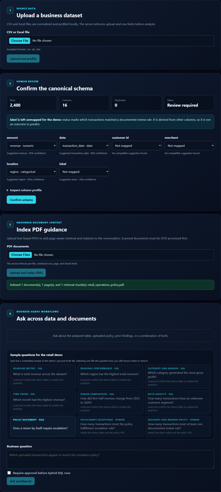
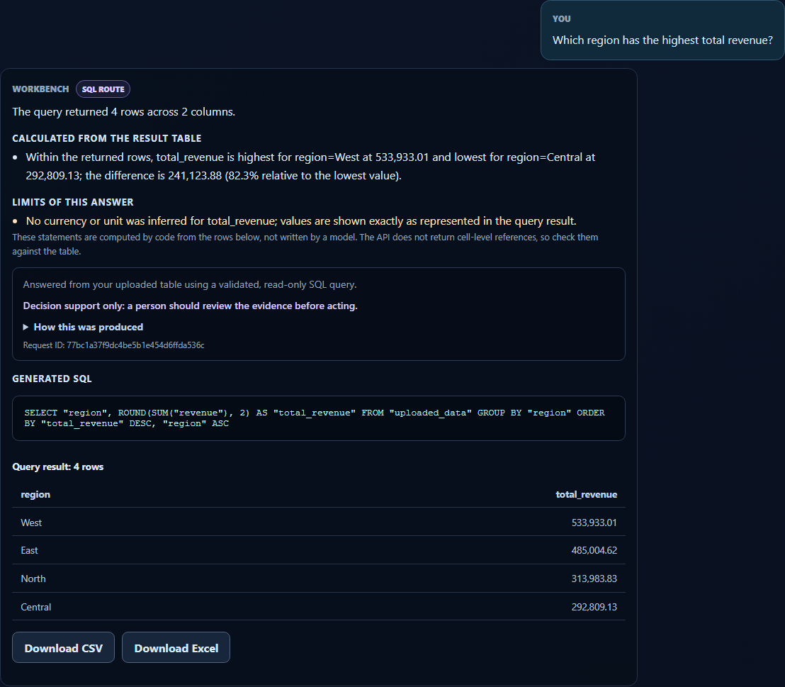
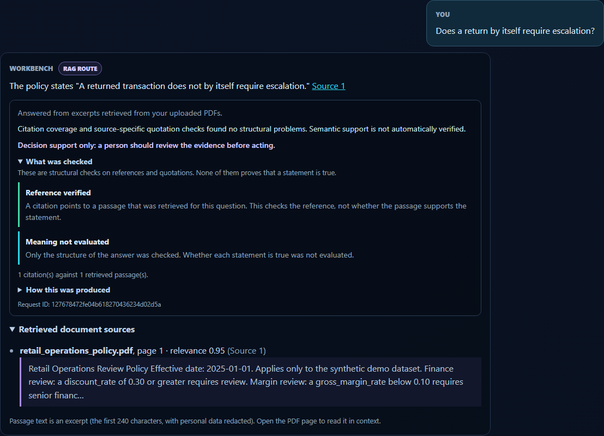
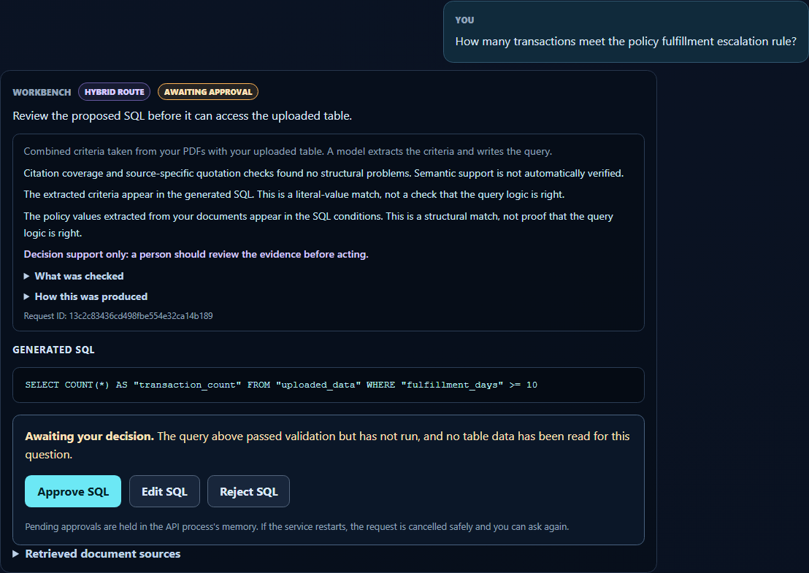
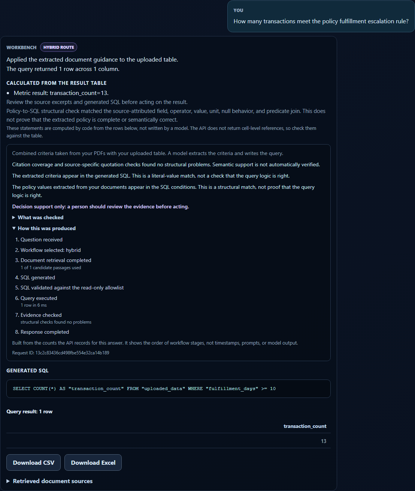
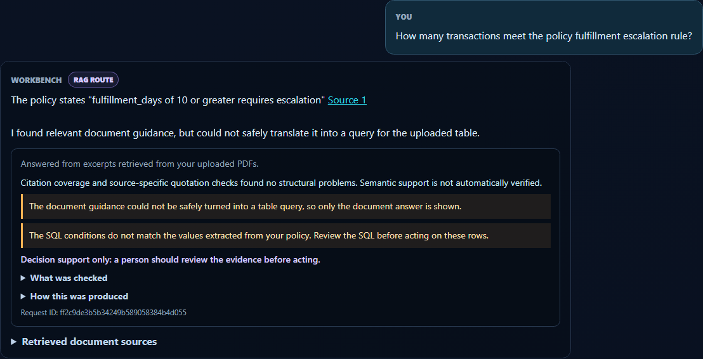
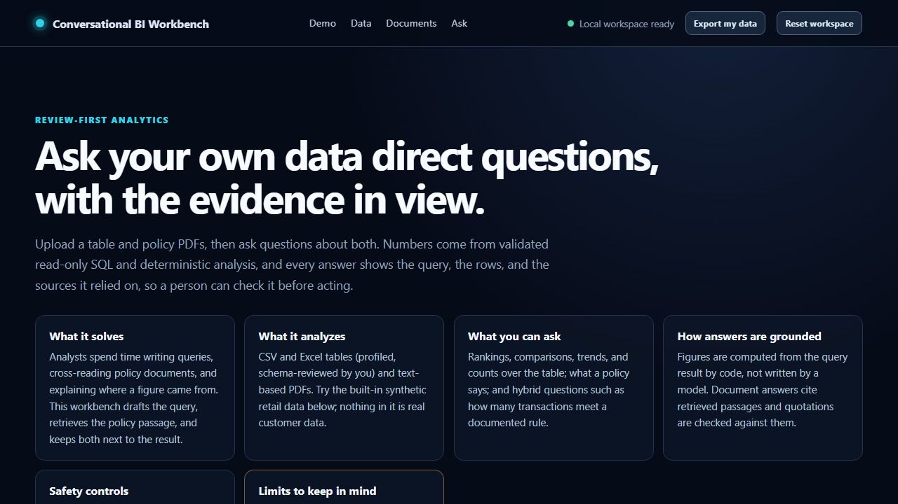
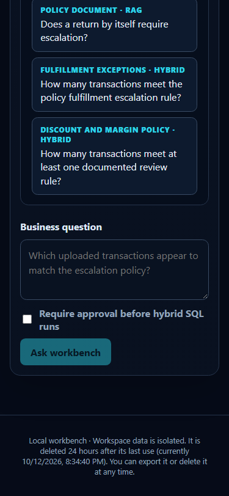

# Browser demo walkthrough (about 8 minutes)

A reproducible tour of the React client using the synthetic retail-operations data. Screenshots are
real captures from the browser journeys in `apps/web/e2e/real/retail-journey.spec.ts`; regenerate
them with `E2E_CAPTURE=1 npm run test:e2e:real` from `apps/web/`.

> **Scripted model.** The automated run and its screenshots use a deterministic scripted provider
> (`tests/e2e/retail_app.py`), not a live model. It returns the route, policy predicates, SQL, and
> quoted sentence a correct model would, so the screenshots show how the application behaves when
> the model behaves. For a live-model demo use your own provider key (see "Live-provider demo").

## Start the stack

Without Docker (what the automated journeys use):

```powershell
python -m venv .venv; .venv\Scripts\Activate.ps1; python -m pip install -r requirements.lock
cd apps/web; npm ci
$env:E2E_DATA_DIR = "work/e2e-data"
python -m uvicorn --factory tests.e2e.retail_app:build_app --port 8000    # terminal 1 (scripted model)
npm run dev                                                               # terminal 2 -> http://localhost:5173
```

With Docker, see [local containers](local-containers.md). Nothing in the Docker path has been
exercised for this walkthrough.

## Script

1. **Orient (1 min).** Open the page. The overview names the problem, the data, what you can ask,
   how answers are grounded, the safety controls, and the limits.
   
2. **Load the demo (1 min).** Press *Load demo data and policy*. It uses the normal upload
   endpoints, so nothing is preloaded or exempt from validation. Review the suggested mapping and
   press *Confirm schema* (the suggested customer ID and label are not meaningful for this table;
   no sample question uses them).
   
3. **Deterministic analysis (1 min).** *Run deterministic analysis*: profile, trends, anomaly
   candidates, a business summary. No model involved.
   
4. **Ask a table question (1 min).** Accept the data-sharing notice, pick *Which region has the
   highest total revenue?*, and send it. Expected: West, 533,933.01. Point out the calculated
   observations, the stated limits (no currency was inferred), the generated SQL, and the rows.
   
5. **Ask a document question (1 min).** *Does a return by itself require escalation?* The answer
   quotes the policy and links "Source 1" to the retrieved passage and page. Open *What was
   checked*: a verified reference means the citation points at a retrieved passage, not that the
   statement is true.
   
6. **Hybrid with approval (2 min).** Tick *Require approval before hybrid SQL runs* and ask *How
   many transactions meet the policy fulfillment escalation rule?* The SQL is shown and nothing has
   run. Try *Edit SQL*: narrowing it keeps the policy threshold and runs; changing `>= 10` to `>= 14`
   makes the system fall back to the document answer because the SQL no longer applies the policy.
   Then approve the original: 13 transactions.
   
   
   
7. **Reload (1 min).** Refresh the page. The workspace, data, and conversation return. Start a
   pending approval and refresh again: it is still pending.
   
8. **Phone width.** Narrow the window to 375 px: no horizontal page scroll.
   

Ground-truth answers for every sample question are in
[`sample_data/retail_operations_ground_truth.json`](../../sample_data/retail_operations_ground_truth.json).

## Live-provider demo

Set `GEMINI_API_KEY` (and accept the consent notice in the UI), start the normal API
(`python -m uvicorn apps.api.main:app --port 8000`), and repeat the script. A live model may route,
write SQL, or quote differently from the script, so some sample questions can be answered
differently or refused. That behavior has **not** been evaluated for this project; do not assume
the scripted results transfer.

## Automated equivalent

```powershell
cd apps/web
npm run build
npm run test:e2e:real      # 20 journeys; starts and stops its own API and web server
```
