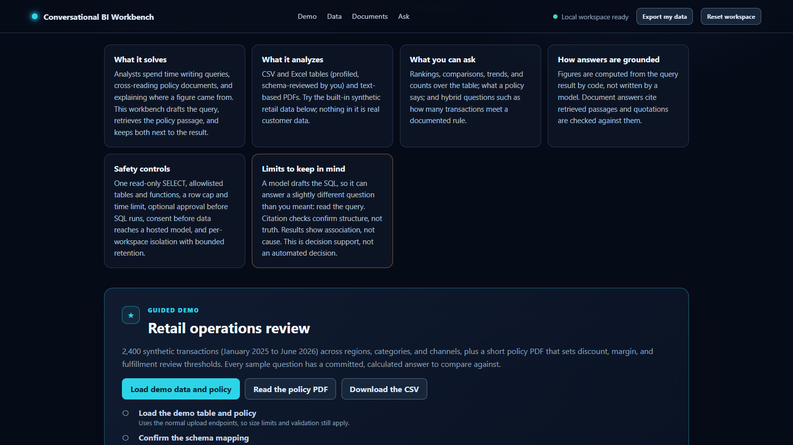
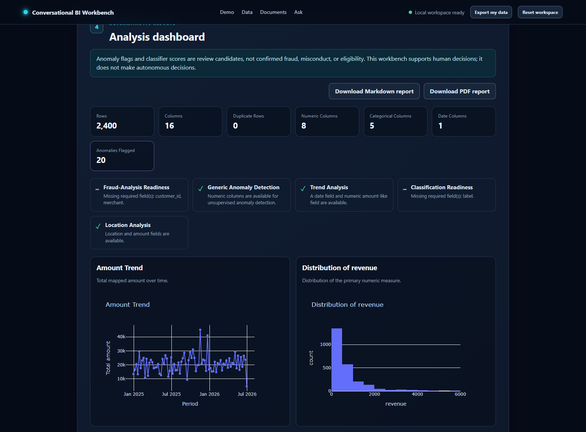
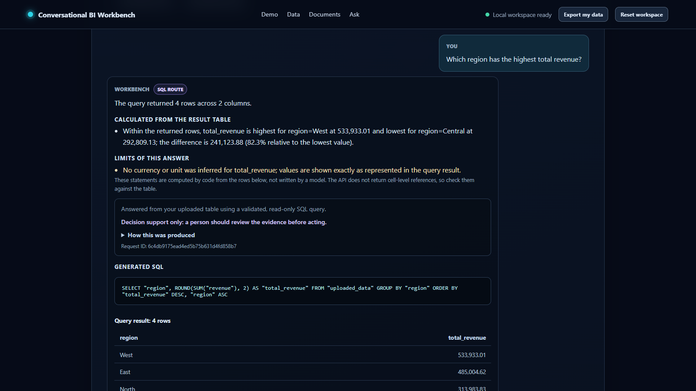
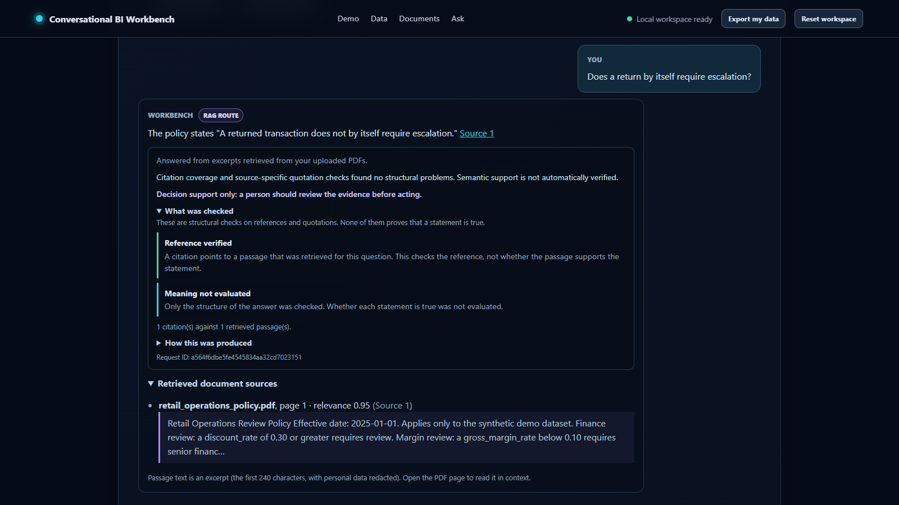
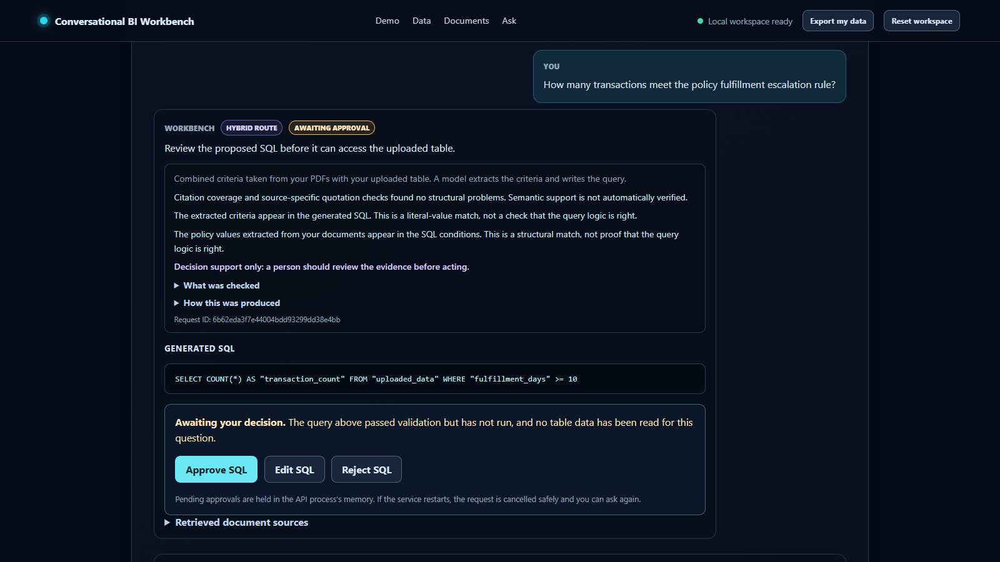
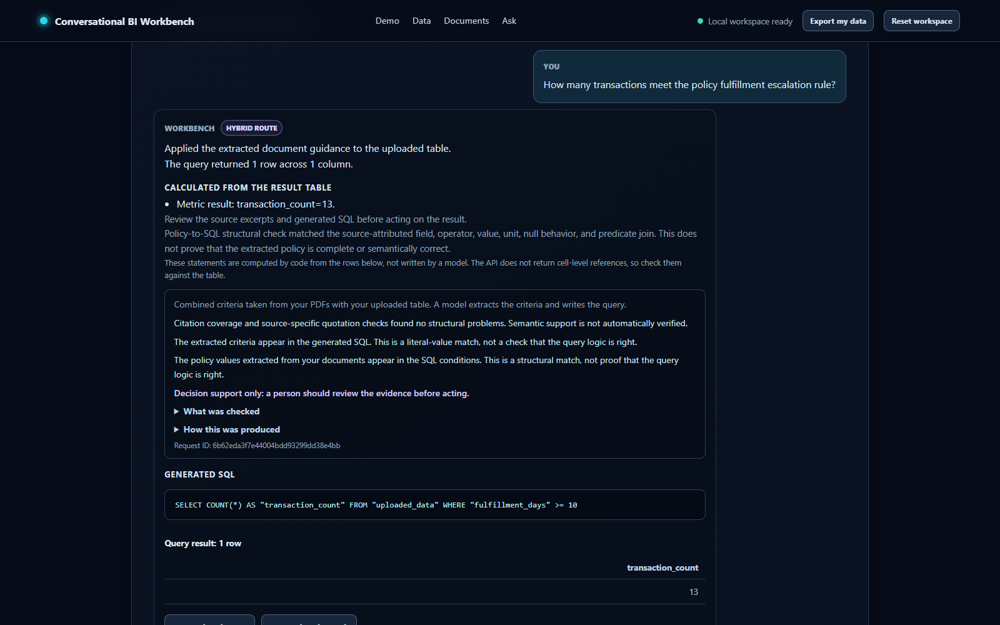

# Portfolio screenshot sequence

These browser captures tell the retail-operations story from workspace setup through an approved
policy-to-SQL result. They come from the React client and production FastAPI application boundary,
driven by the test-only deterministic scripted provider in `tests/e2e/retail_app.py`. The provider
returns fixed, fixture-aligned routing, document-answer, criteria, and SQL proposals so the journey
can verify the application's behavior without contacting a hosted model.

The captures therefore demonstrate reproducible UI behavior, deterministic analytics, guarded SQL,
retrieval evidence, and approval controls. They do **not** establish live-model accuracy or
reliability.

## 1. Product and workspace overview

The opening workspace explains the supported table and PDF inputs, how evidence stays next to an
answer, and which safety controls govern SQL and hosted-provider access. The guided demo uses 2,400
committed synthetic transactions rather than customer data.

## 2. Deterministic business analytics

The analysis path profiles the uploaded table and renders code-computed KPIs and charts. The capture
shows all 2,400 rows, 16 columns, no duplicate rows, 20 anomaly candidates, readiness indicators,
and complete revenue trend and distribution charts. These outputs do not depend on a language-model
answer.

## 3. Natural-language SQL with result evidence

For the question about the highest-revenue region, the workbench exposes the validated read-only SQL,
the returned rows, and a summary calculated from those rows. The committed fixture identifies West
as the highest-revenue region at `533933.01`; the UI also states that no currency or unit was inferred.

## 4. Document answer with a PDF citation

The document route cites `retail_operations_policy.pdf`, page 1, for the statement that a return by
itself does not require escalation. The evidence panel distinguishes a structurally verified
reference and quotation from semantic truth: retrieval and citation checks do not prove that a
source is correct.

## 5. Human approval before SQL execution

The hybrid route extracts the policy predicate `fulfillment_days >= 10`, validates the proposed SQL,
and pauses at a server-owned approval boundary. At this point the query has not run and no table data
has been read for the question. A reviewer can approve, reject, or edit it; an edit must pass the
complete safety and policy-validation path again.

## 6. Approved policy-to-SQL result

After approval, the validated query runs against the read-only workspace and returns 13 matching
transactions. The application calculates that result from the query row, keeps the source-attributed
predicate and SQL visible, and preserves the decision-support caveats.

## Committed fixture and expected values

The screenshots use `sample_data/retail_operations.csv`,
`sample_data/retail_operations_policy.pdf`, and
`sample_data/retail_operations_ground_truth.json`. The committed expectations exercised by the
browser journey include:

- 2,400 synthetic transactions;
- West as the highest-revenue region, with `533933.01` total revenue;
- a fulfillment escalation threshold of `fulfillment_days >= 10`;
- 13 transactions matching that fulfillment threshold; and
- a return alone not requiring escalation.

The automated browser journey checks these fixture values along with rejection, edit/revalidation,
workspace recovery, responsive layout, and accessibility behavior. Scripted-provider success proves
that the application responds correctly to known proposals and failures; evaluating a hosted model's
quality requires separate, repeated live-provider evidence.

The committed `npm run test:e2e:real` command reproduces the 20 scripted-provider journeys. Setting
`E2E_CAPTURE` regenerates the historical demo captures at their committed destinations; it does not
reproduce these exact portfolio crops in an isolated output directory. The portfolio capture used
ignored candidate directories and narrow temporary viewport/isolation adjustments that were reverted
afterward, so those adjustments are not a permanently supported command-line interface.

For the reproducible demonstration narrative and operating commands, see the
[browser demo walkthrough](operations/demo-walkthrough.md). For the engineering boundary between
deterministic code and model assistance, see the
[portfolio walkthrough](portfolio-walkthrough.md).
